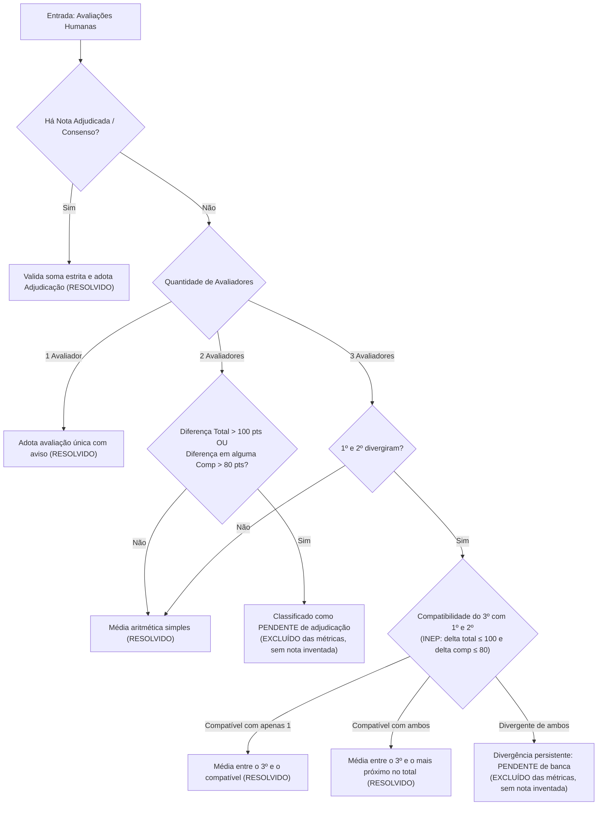

# Formato de Dados e Metodologia do Benchmark (ENEM)

Este documento especifica a estrutura técnica, regras de validação, tratamento de divergências entre corretores e diretrizes de privacidade do Benchmark de Redações do Vestibular+.

---

## 1. Visão Geral da Arquitetura

O benchmark foi projetado para operar **100% offline**, garantindo:
- **Reprodutibilidade:** Os cálculos de proximidade e métricas são determinísticos e matematicamente rigorosos.
- **Privacidade absoluta:** Nenhuma redação, dado de usuário ou segredo trafega pela rede ou consome tokens de IA durante a execução.
- **Isolamento de calibração:** As notas da IA nunca são adulteradas artificialmente para "atingir" a referência; o benchmark é uma ferramenta de auditoria da proximidade real.
- **Integridade da Referência Humana:** Casos com divergências humanas não resolvidas são formalmente classificados como **pendentes** e excluídos das métricas de desempenho para não distorcer a avaliação do corretor com médias fictícias.

---

## 2. Estrutura do Arquivo de Dados (JSON Schema)

O benchmark aceita um arquivo `.json` contendo um objeto ou array de casos. A estrutura recomendada é um objeto com metadados e o array `casos`:

```json
{
  "versao_schema": "1.0.0",
  "eh_demonstracao": false,
  "banca": "enem",
  "descricao": "Conjunto de redações com avaliações humanas de referência",
  "casos": [
    {
      "id": "identificador-unico-da-redacao",
      "tema": "Tema oficial da proposta de redação",
      "texto": "Texto completo da redação desidentificada...",
      "avaliacoes_humanas": [
        {
          "avaliador_id": "avaliador-1",
          "tipo": "corretor_oficial",
          "competencias": { "c1": 160, "c2": 160, "c3": 160, "c4": 160, "c5": 160 },
          "nota_total": 800
        },
        {
          "avaliador_id": "avaliador-2",
          "tipo": "corretor_oficial",
          "competencias": { "c1": 160, "c2": 120, "c3": 160, "c4": 160, "c5": 160 },
          "nota_total": 760
        }
      ],
      "nota_adjudicada": {
        "tipo": "consenso_banca",
        "competencias": { "c1": 160, "c2": 160, "c3": 160, "c4": 160, "c5": 160 },
        "nota_total": 800
      },
      "correcao_ia": {
        "modelo": "modelo-usado",
        "competencias": { "c1": 160, "c2": 160, "c3": 160, "c4": 160, "c5": 160 },
        "nota_total": 800
      }
    }
  ]
}
```

### Campos Obrigatórios por Caso:
- `id`: Identificador único da redação (string).
- `tema`: Tema da redação (string não vazia).
- `texto`: Texto da redação (string não vazia).
- `correcao_ia`: Objeto contendo as notas atribuídas pela IA (`c1` a `c5` e `nota_total`).
- `avaliacoes_humanas` **OU** `nota_adjudicada` / `referencia`: Ao menos uma forma de referência humana.

---

## 3. Escala Oficial do ENEM e Regras de Validação

- **Competências:** Exatamente 5 competências independentes:
  - **C1:** Domínio da norma culta escrita (0 a 200).
  - **C2:** Compreensão da proposta e aplicação de repertório (0 a 200).
  - **C3:** Seleção, organização e interpretação de argumentos (0 a 200).
  - **C4:** Recursos coesivos (0 a 200).
  - **C5:** Proposta de intervenção social (0 a 200).
- **Incrementos Oficiais:** As notas individuais de todos os corretores humanos (1º, 2º, 3º e demais) e da IA devem pertencer estritamente aos incrementos de 40 pontos:  
  `[0, 40, 80, 120, 160, 200]`.
- **Nota Total:** É a soma estrita das 5 competências (`0 a 1000 pontos`). A nota total informada para adjudicações ou correções deve obrigatoriamente coincidir com a soma das competências. Valores inconsistentes ou fora do intervalo são rejeitados na validação.
- **Valores Intermediários (Médias):** Notas com valores intermediários (ex.: 140, 100) são aceitas exclusivamente como resultado de médias de corretores concordantes.

---

## 4. Metodologia de Resolução de Divergências entre Avaliadores

O benchmark implementa as normas oficiais de correção do ENEM (INEP), distinguindo rigorosamente **casos resolvidos** de **casos pendentes**:



### Casos Resolvidos vs. Casos Pendentes:
1. **Casos Resolvidos:** Possuem referência humana legítima consolidada (média simples concordante, resolução pelo 3º corretor com o par compatível, ou adjudicação de consenso). São os **únicos** contabilizados no cálculo de proximidade e métricas do benchmark.
2. **Casos Pendentes:**
   - **Dois corretores divergentes sem 3º avaliador nem adjudicação:** Marcados como `status: 'pendente_adjudicacao'`. Não se inventa média provisória; o caso é excluído das métricas de acurácia da IA e listado para auditoria.
   - **Três corretores com divergência persistente:** Quando o 3º corretor diverge de ambos os corretores anteriores, a norma do ENEM determina encaminhamento para banca examinadora presencial. O benchmark marca o caso como `status: 'pendente_banca'` e o exclui do cálculo de desempenho.

---

## 5. Métricas Calculadas e Esclarecimento Metodológico

| Métrica | Descrição |
|---|---|
| **MAE Total** | Erro Absoluto Médio da nota total: $\frac{1}{N}\sum \|IA_{total} - Ref_{total}\|$ |
| **MAE por Competência** | Erro Absoluto Médio individual para C1, C2, C3, C4 e C5 |
| **Viés Médio (Bias)** | Média das diferenças com sinal: $\frac{1}{N}\sum (IA - Ref)$. Indica tendência sistemática de superestimação ($> 0$) ou subestimação ($< 0$) |
| **Exatidão (%)** | Percentual de redações em que a nota da IA foi idêntica à referência |
| **Faixa de ±40 pontos por Competência (%)** | Percentual de notas a uma distância máxima de 40 pontos da referência (corresponde exatamente a 1 nível da rubrica do ENEM) |
| **Faixa de ±40 pontos na Nota Total (%)** | Métrica operacional de proximidade agregada adotada pelo benchmark (**ver esclarecimento abaixo**) |
| **Faixa de ±80 pontos por Competência (%)** | Percentual dentro da faixa de tolerância de discrepância do INEP |
| **Discrepâncias Críticas (%)** | Percentual de ocorrências com desvio $> 80$ pontos em uma competência |
| **Ranking de Afastamento** | Ordenação decrescente das competências por MAE para orientar a calibração pedagógica prioritária |

> [!NOTE]
> **Esclarecimento sobre a métrica de ±40 pontos na nota total:**
> Nas competências individuais, 40 pontos representam rigorosamente um salto de nível na rubrica oficial (ex: nível 3 para nível 4). Na **nota total (0 a 1000 pontos)**, a faixa de ±40 pontos foi escolhida como uma tolerância estatística operacional agregada para o benchmark. Ela **não** representa equivalência pedagógica estrita nem garantia de precisão idêntica da banca real, pois uma variação total de 40 pontos pode decorrer de um desconto isolado em uma única competência ou de compensações cruzadas entre múltiplos critérios.

---

## 6. Diretrizes de Privacidade e Dados Reais

> [!CAUTION]
> **Proteção de Dados Pessoais (LGPD):**
> 1. **Nunca versione redações com autoria identificável:** Nomes de estudantes, números de matrícula, CPF, e-mails, escolas ou assinaturas devem ser desidentificados antes do armazenamento.
> 2. **Autorização:** Apenas utilize redações autorizadas formalmente para fins de pesquisa e calibração pedagógica.
> 3. **Segurança de Segredos:** Nunca insira tokens do Supabase, chaves de API (`GROQ_API_KEY`, `OPENAI_API_KEY`) ou senhas em arquivos de benchmark ou logs.

---

## 7. Como Executar o Benchmark

### Execução Padrão (utiliza o conjunto de demonstração técnica):
```bash
node benchmark/runner.js
```

### Execução com Arquivo Personalizado:
```bash
node benchmark/runner.js caminho/para/meu-dataset.json
```

### Exportação do Relatório para Markdown:
```bash
node benchmark/runner.js caminho/para/meu-dataset.json --output relatorio-calibracao.md
```
