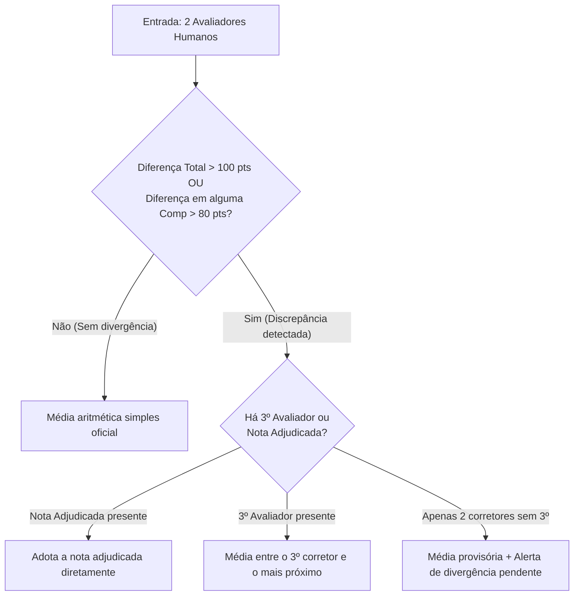

# Formato de Dados e Metodologia do Benchmark (ENEM)

Este documento especifica a estrutura técnica, regras de validação, tratamento de divergências entre corretores e diretrizes de privacidade do Benchmark de Redações do Vestibular+.

---

## 1. Visão Geral da Arquitetura

O benchmark foi projetado para operar **100% offline**, garantindo:
- **Reprodutibilidade:** Os cálculos de proximidade e métricas são determinísticos e matematicamente rigorosos.
- **Privacidade absoluta:** Nenhuma redação, dado de usuário ou segredo trafega pela rede ou consome tokens de IA durante a execução.
- **Isolamento de calibração:** As notas da IA nunca são adulteradas artificialmente para "atingir" a referência; o benchmark é uma ferramenta de auditoria da proximidade real.

---

## 2. Estrutura do Arquivo de Dados (JSON Schema)

O benchmark aceita um arquivo `.json` contendo um objeto ou array de casos. A estrutura recomendada é um objeto com metadados e o array `casos`:

```json
{
  "versao_schema": "1.0.0",
  "eh_demonstracao": false,
  "banca": "enem",
  "descricao": "Conjunto de redações com avaliações humanas de referência",
  "casos": [
    {
      "id": "identificador-unico-da-redacao",
      "tema": "Tema oficial da proposta de redação",
      "texto": "Texto completo da redação desidentificada...",
      "avaliacoes_humanas": [
        {
          "avaliador_id": "avaliador-1",
          "tipo": "corretor_oficial",
          "competencias": { "c1": 160, "c2": 160, "c3": 160, "c4": 160, "c5": 160 },
          "nota_total": 800
        },
        {
          "avaliador_id": "avaliador-2",
          "tipo": "corretor_oficial",
          "competencias": { "c1": 160, "c2": 120, "c3": 160, "c4": 160, "c5": 160 },
          "nota_total": 760
        }
      ],
      "nota_adjudicada": {
        "tipo": "consenso_banca",
        "competencias": { "c1": 160, "c2": 160, "c3": 160, "c4": 160, "c5": 160 },
        "nota_total": 800
      },
      "correcao_ia": {
        "modelo": "modelo-usado",
        "competencias": { "c1": 160, "c2": 160, "c3": 160, "c4": 160, "c5": 160 },
        "nota_total": 800
      }
    }
  ]
}
```

### Campos Obrigatórios por Caso:
- `id`: Identificador único da redação (string).
- `tema`: Tema da redação (string não vazia).
- `texto`: Texto da redação (string não vazia).
- `correcao_ia`: Objeto contendo as notas atribuídas pela IA (`c1` a `c5` e `nota_total`).
- `avaliacoes_humanas` **OU** `nota_adjudicada` / `referencia`: Ao menos uma forma de referência humana.

---

## 3. Escala Oficial do ENEM e Regras de Validação

- **Competências:** Exatamente 5 competências independentes:
  - **C1:** Domínio da norma culta escrita (0 a 200).
  - **C2:** Compreensão da proposta e aplicação de repertório (0 a 200).
  - **C3:** Seleção, organização e interpretação de argumentos (0 a 200).
  - **C4:** Recursos coesivos (0 a 200).
  - **C5:** Proposta de intervenção social (0 a 200).
- **Incrementos Oficiais:** As notas individuais de corretores humanos e da IA devem obrigatoriamente pertencer aos níveis oficiais de 40 pontos:  
  `[0, 40, 80, 120, 160, 200]`.
- **Nota Total:** É a soma estrita das 5 competências (`0 a 1000 pontos`). Notas que divirjam da soma ou valores negativos/fracionários são rejeitados com aviso de inconsistência.
- **Valores Intermediários (Médias):** Notas com valores médios (ex.: 140, 100) são aceitas exclusivamente para notas de referência derivadas de médias entre múltiplos avaliadores.

---

## 4. Metodologia de Resolução de Divergências entre Avaliadores

O benchmark implementa fielmente as normas de correção do INEP (Ministério da Educação):



1. **Precedência da Adjudicação/Consenso:**  
   Se o registro fornecer explicitamente `nota_adjudicada`, `nota_consenso` ou `referencia`, esse valor tem precedência imediata sobre avaliações individuais.
2. **Dois Corretores Concordantes:**  
   Se o delta na nota total for $\le 100$ e o delta em todas as competências for $\le 80$, a referência é a média aritmética simples de cada competência.
3. **Três Corretores (Desempate):**  
   Quando há discrepância e o 3º corretor é acionado, a nota final é a média entre o 3º corretor e o corretor cuja nota total estiver mais próxima da sua.
4. **Divergência Pendente:**  
   Se houver divergência grave entre 2 corretores e nenhum 3º corretor ou consenso estiver disponível, o benchmark calcula a média aritmética para fins estatísticos, mas emite um alerta explícito (`discrepancia_humana: true`) para revisão manual.

---

## 5. Métricas Calculadas

| Métrica | Descrição |
|---|---|
| **MAE Total** | Erro Absoluto Médio da nota total: $\frac{1}{N}\sum \|IA_{total} - Ref_{total}\|$ |
| **MAE por Competência** | Erro Absoluto Médio individual para C1, C2, C3, C4 e C5 |
| **Viés Médio (Bias)** | Média das diferenças com sinal: $\frac{1}{N}\sum (IA - Ref)$. Indica tendência sistemática de superestimação ($> 0$) ou subestimação ($< 0$) |
| **Exatidão (%)** | Percentual de redações em que a nota da IA foi idêntica à referência |
| **Faixa de ±40 pontos (%)** | Percentual de notas a uma distância máxima de 40 pontos da referência (tolerância de 1 nível de rubrica do ENEM) |
| **Faixa de ±80 pontos (%)** | Percentual dentro da faixa de aceitabilidade do INEP |
| **Discrepâncias Críticas (%)** | Percentual de ocorrências com desvio $> 80$ pontos em uma competência |
| **Ranking de Afastamento** | Ordenação decrescente das competências por MAE para orientar a calibração pedagógica prioritária |

---

## 6. Diretrizes de Privacidade e Dados Reais

> [!CAUTION]
> **Proteção de Dados Pessoais (LGPD):**
> 1. **Nunca versione redações com autoria identificável:** Nomes de estudantes, números de matrícula, CPF, e-mails, escolas ou assinaturas devem ser desidentificados antes do armazenamento.
> 2. **Autorização:** Apenas utilize redações autorizadas formalmente para fins de pesquisa e calibração pedagógica.
> 3. **Segurança de Segredos:** Nunca insira tokens do Supabase, chaves de API (`GROQ_API_KEY`, `OPENAI_API_KEY`) ou senhas em arquivos de benchmark ou logs.

---

## 7. Como Executar o Benchmark

### Execução Padrão (utiliza o conjunto de demonstração técnica):
```bash
node benchmark/runner.js
```

### Execução com Arquivo Personalizado:
```bash
node benchmark/runner.js caminho/para/meu-dataset.json
```

### Exportação do Relatório para Markdown:
```bash
node benchmark/runner.js caminho/para/meu-dataset.json --output relatorio-calibracao.md
```
